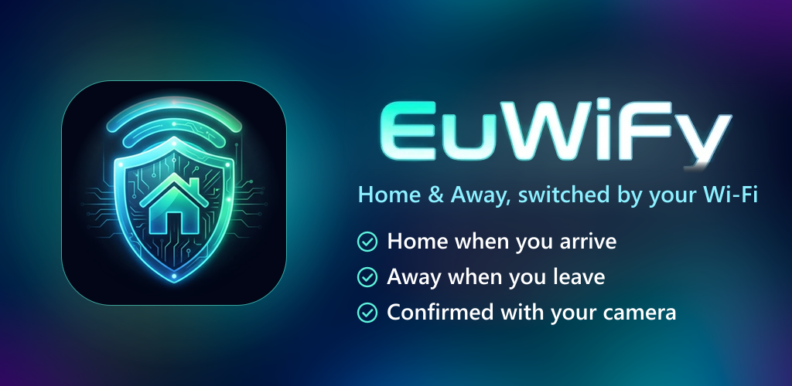

<p align="center"></p>

# EuWiFy

**Home and Away for your Eufy camera, switched automatically by Wi-Fi.**

EuWiFy is a small Android app that switches an Eufy security camera between **Home** and **Away** guard mode based on the Wi-Fi your phone is connected to:

- On one of your home Wi-Fi networks → **Home** right away
- No home Wi-Fi for 75 seconds → **Away**
- Every change is **confirmed with the camera**, then shown as a notification
- Runs in the background and starts again after the phone restarts
- Everyone signs in with their own Eufy account; the login stays encrypted on the phone

It was built because Eufy's own geofencing was unreliable, and smart-speaker routines were not an option.

> ⚠️ **Not affiliated with Anker or Eufy.** EuWiFy uses an unofficial, community-made interface ([eufy-security-client](https://github.com/bropat/eufy-security-client)). That project is no longer maintained, and Eufy can change or switch off the interface at any time. Use at your own risk.

## Tested with

| Camera | Model | HomeBase | Status |
|---|---|---|---|
| Indoor Cam Pan & Tilt 2K | T8410 | none | ✅ works |

Other Eufy cameras and HomeBase setups may work, but have not been tested yet. Reports are welcome in [Issues](../../issues).

## Requirements

- Android 8.0 or newer (64-bit ARM phone)
- Your **main** Eufy account (guest accounts cannot see the camera's guard mode)
- Permissions: location "all the time" (Android only reveals the Wi-Fi *name* to apps with location permission), notifications, and no battery restriction

## Privacy in short

- Your Eufy email and password are stored **only on your phone**, encrypted with a key in the Android Keystore, and are only sent to Eufy's servers.
- The Wi-Fi name is read on the phone and **never sent anywhere**. GPS is not used.
- No analytics, no ads, no tracking, no server of our own.
- Nothing is included in Android backups.

Full text: [PRIVACY.md](PRIVACY.md)

## How it works

```
Android app (Kotlin)                      Node.js inside the app (nodejs-mobile)
 ├─ Foreground service                     └─ main.js
 │   ├─ watches Wi-Fi (NetworkCallback)        ├─ eufy-security-client → Eufy cloud + camera (P2P)
 │   ├─ decides Home / Away                     └─ tiny HTTP API on 127.0.0.1 (random port,
 │   └─ notifications                               every request needs a per-run secret)
 └─ Settings screen  ──── HTTP + secret ────►
```

## Building

You need Android Studio, Node.js 24 + npm and Windows PowerShell.

```powershell
git clone https://github.com/n0br4n/euwify.git
cd euwify
# 1. Download the nodejs-mobile library (~80 MB, not stored in git)
powershell -ExecutionPolicy Bypass -File scripts\get-libnode.ps1
# 2. Only if you changed nodejs/: rebuild the Node part of the app
powershell -ExecutionPolicy Bypass -File scripts\build-node-assets.ps1
```

Then open the folder in Android Studio and press **Run** with a real phone connected (the emulator is not supported: only arm64 is built).

## Support the project ☕

If EuWiFy saves you some trouble, you can buy me a coffee:

- **Revolut:** [revolut.me/nobran](https://revolut.me/nobran)
- **PayPal:** [paypal.me/tayfunorge](https://www.paypal.com/paypalme/tayfunorge)

Thank you!

## License

[MIT](LICENSE). Uses [nodejs-mobile](https://github.com/nodejs-mobile/nodejs-mobile) and [eufy-security-client](https://github.com/bropat/eufy-security-client) (both MIT).
